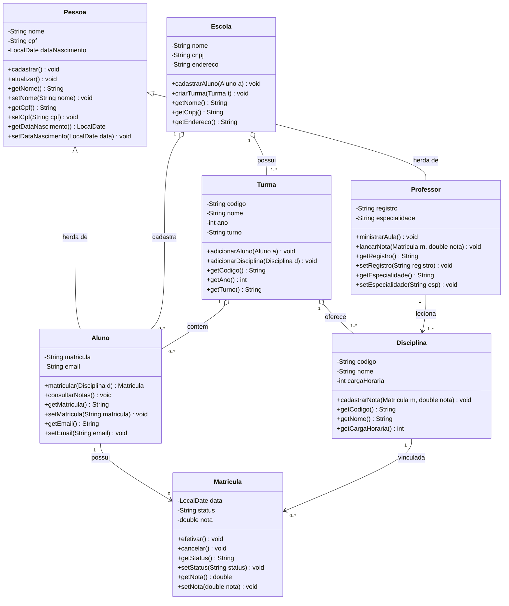
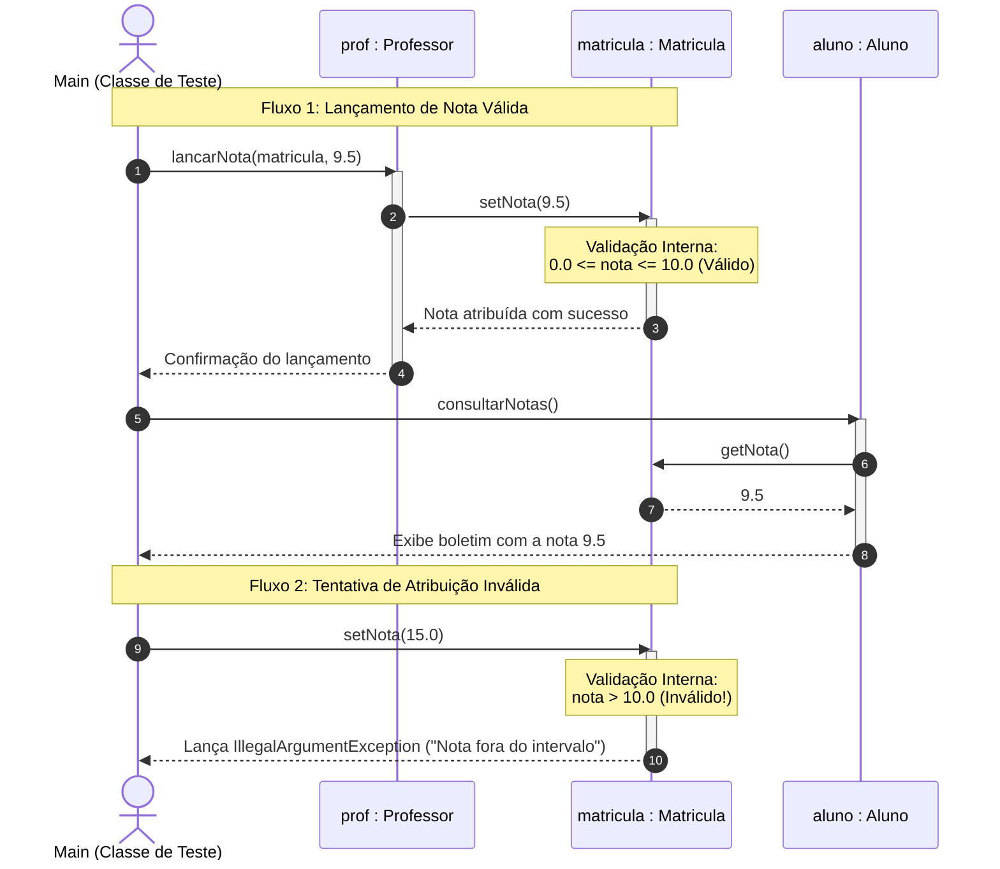

# 🎓 Sistema de Gestão Escolar — Programação Orientada a Objetos (POO)


Projeto acadêmico desenvolvido para a disciplina de **Desenvolvimento Orientado a Objetos (6º Período)**. O sistema modela e implementa a gestão estrutural e acadêmica de uma instituição de ensino, abrangendo entidades como pessoas, alunos, professores, turmas, disciplinas e matrículas.

---

## 📌 Sumário

- [Visão Geral e Fases](#-visão-geral-e-fases)
- [Conceitos de POO Aplicados](#-conceitos-de-poo-aplicados)
- [Diagramas do Sistema (UML)](#-diagramas-do-sistema-uml)
  - [Diagrama de Classes](#1-diagrama-de-classes-estrutural)
  - [Diagrama de Sequência](#2-diagrama-de-sequência-comportamental)
- [Regras de Validação (Encapsulamento)](#-regras-de-validação-encapsulamento)
- [Estrutura do Projeto](#-estrutura-do-projeto)
- [Como Compilar e Executar](#-como-compilar-e-executar)
  - [Opção 1: Atalho Automático (Windows)](#opção-1-atalho-automático-windows)
  - [Opção 2: Terminal Manual (PowerShell / Bash)](#opção-2-terminal-manual-powershell--bash)
- [Resultados dos Testes Experimentais](#-resultados-dos-testes-experimentais)
- [Tecnologias Utilizadas](#-tecnologias-utilizadas)

---

## 🎯 Visão Geral e Fases

O projeto foi dividido em etapas evolutivas:

* **Fase 01 (Modelagem Conceitual):** Escolha do domínio escolar, definição das classes fundamentais, identificação de atributos, métodos e relacionamentos iniciais em UML (StarUML).
* **Fase 02 (Implementação e Encapsulamento):** Transposição do modelo conceitual para código Java 17 LTS, com foco rigoroso em **Encapsulamento**, programação defensiva (*Fail-Fast*) e proteção contra estados inconsistentes através de métodos *getters* e *setters* com validação.

---

## 💡 Conceitos de POO Aplicados

1. **Encapsulamento Rígido:** Todos os atributos de todas as classes possuem modificador de visibilidade `private`. O acesso e a mutação ocorrem unicamente por métodos públicos.
2. **Validação Defensiva (Fail-Fast):** Os métodos *setters* validam dados de entrada (como limites de nota, regras de CPF, e-mail e strings não vazias) e disparam `IllegalArgumentException` caso detectem valores ilegais.
3. **Proteção na Instanciação:** Os construtores parametrizados invocam os próprios *setters*, impedindo que objetos nasçam com atributos em estado inválido.
4. **Herança e Polimorfismo:** `Aluno` e `Professor` herdam de `Pessoa`, compartilhando atributos comuns (`nome`, `cpf`, `dataNascimento`) e especializando comportamentos.
5. **Encapsulamento de Coleções:** Métodos de acesso para listas retornam visões imutáveis (`Collections.unmodifiableList`), forçando adições e remoções a utilizarem métodos de negócio dedicados.

---

## 📐 Diagramas do Sistema (UML)

### 1. Diagrama de Classes (Estrutural)



---

### 2. Diagrama de Sequência (Comportamental)

Demonstração do fluxo temporal de invocação e do encapsulamento em ação durante os testes do método `Main`:



---

## 🛡️ Regras de Validação (Encapsulamento)

| Entidade | Atributo | Modificador | Validação Aplicada no Setter |
|---|---|---|---|
| `Pessoa` | `nome` | `private` | Não nulo, não vazio, mínimo de 2 caracteres. |
| `Pessoa` | `cpf` | `private` | Remove caracteres especiais e exige exatamente 11 dígitos numéricos. |
| `Pessoa` | `dataNascimento` | `private` | Não nula e não futura (suporta formato `dd/MM/yyyy` e ISO). |
| `Aluno` | `matricula` | `private` | Não nula e não vazia. Identificador único do discente. |
| `Aluno` | `email` | `private` | Expressão regular validando padrão formal (`usuario@dominio.com`). |
| `Professor` | `registro` | `private` | Não nulo e não vazio (código funcional docente). |
| `Professor` | `especialidade` | `private` | Não nula e não vazia (área de atuação acadêmica). |
| `Escola` | `cnpj` | `private` | Validação de formato obrigatório com 14 dígitos numéricos. |
| `Turma` | `ano` | `private` | Restrito ao intervalo válido entre 2000 e 2100. |
| `Disciplina` | `cargaHoraria` | `private` | Carga horária estritamente superior a zero ($> 0$). |
| `Matricula` | `status` | `private` | Apenas valores válidos: `ATIVA`, `CANCELADA`, `CONCLUIDA`, `TRANCADA`. |
| `Matricula` | `nota` | `private` | **Regra crítica:** nota deve estar estritamente entre `0.0` e `10.0`. |

---

## 📂 Estrutura do Projeto

```text
├── src/
│   └── escola/
│       ├── Pessoa.java           # Superclasse base com nome, cpf e dataNascimento
│       ├── Aluno.java            # Subclasse com matricula, email e boletim
│       ├── Professor.java        # Subclasse com registro, especialidade e lancarNota()
│       ├── Escola.java           # Instituição com turmas e alunos
│       ├── Turma.java            # Turma com alunos, disciplinas, ano e turno
│       ├── Disciplina.java       # Disciplina com código, nome, carga horária e professor
│       ├── Matricula.java        # Vínculo associativo entre Aluno e Disciplina com nota
│       └── Main.java             # Demonstração executável de fluxo e validação
├── bin/                          # Bytecodes compilados (.class)
├── Desenvolvimento_POO_Fase02.docx # Relatório formatado no modelo institucional
├── RELATORIO_FASE_02.md          # Relatório técnico completo da Fase 02
├── COMO_EXECUTAR.md              # Guia passo a passo para iniciantes
├── Desenvolvimento_POO.md        # Documentação completa de evolução do projeto
├── executar.bat                  # Script de execução rápida em 1 clique (Windows)
└── README.md                     # Apresentação do repositório
```

---

## ⚙️ Como Compilar e Executar

### Pré-requisitos
- **Java JDK 11 ou superior** instalado (desenvolvido e testado no **Java 17 LTS**).

### Opção 1: Atalho Automático (Windows)
Dê um duplo clique no arquivo [`executar.bat`](executar.bat) ou digite no terminal:
```powershell
.\executar.bat
```

### Opção 2: Terminal Manual (PowerShell / Bash)
1. **Compilar os arquivos fonte:**
   ```bash
   javac -encoding UTF-8 -d bin src/escola/*.java
   ```
2. **Executar a classe principal:**
   ```bash
   java "-Dfile.encoding=UTF-8" -cp bin escola.Main
   ```

---

## 🧪 Resultados dos Testes Experimentais

A execução da classe `Main` realiza duas baterias de testes:

```text
======================================================================
   FASE 02: DEMONSTRAÇÃO PRÁTICA DE ENCAPSULAMENTO E BOAS PRÁTICAS   
======================================================================

--- 1. Instanciação e Manipulação de Objetos Válidos ---
[OK] Escola: Colégio Futuro Brilhante | CNPJ: 12345678000199 | Endereço: Av. Universitária, 1000 | Qtd. Turmas: 0
[Pessoa] Cadastro realizado com sucesso para: Carlos Eduardo
[OK] Nome: Carlos Eduardo | CPF: 11122233344 | Data Nasc.: 20/05/1982 | Registro: PROF-2024-01 | Especialidade: Programação Orientada a Objetos
[Pessoa] Cadastro realizado com sucesso para: Maria Eduarda Souza
[OK] Nome: Maria Eduarda Souza | CPF: 99988877766 | Data Nasc.: 15/03/2005 | Matrícula: ALU-2026-987 | E-mail: maria.souza@faculdade.edu.br
[Escola Colégio Futuro Brilhante] Turma criada: Engenharia de Software - 6º Período (T-2026-N)
[Escola Colégio Futuro Brilhante] Aluno cadastrado: Maria Eduarda Souza
[Turma T-2026-N] Aluno adicionado com sucesso: Maria Eduarda Souza
[Turma T-2026-N] Disciplina vinculada à turma: Programação Orientada a Objetos
[Aluno] Maria Eduarda Souza matriculado na disciplina: Programação Orientada a Objetos
[OK] Matrícula [ATIVA] Aluno: Maria Eduarda Souza | Disciplina: Programação Orientada a Objetos | Data: 19/10/2026 | Nota: 0,0
[Professor] O(a) Prof(a). Carlos Eduardo está ministrando aula de Programação Orientada a Objetos.
[Professor] O(a) Prof(a). Carlos Eduardo lançou a nota 9.5 para o(a) aluno(a) Maria Eduarda Souza na disciplina Programação Orientada a Objetos
=== Boletim de Notas: Maria Eduarda Souza (Matrícula: ALU-2026-987) ===
Disciplina: Programação Orientada a Objetos | Nota: 9.5 | Status: ATIVA
=========================================================

--- 2. Testando a Proteção do Encapsulamento contra Dados Inválidos ---
Tentativas de atribuir dados incorretos via setters serão barradas:

[TESTE] Tentativa de lançar nota acima do limite (15.0) -> PROTEGIDO COM SUCESSO! Exceção capturada: "Erro de validação: A nota deve estar entre 0.0 e 10.0. Valor informado: 15.0"
[TESTE] Tentativa de lançar nota negativa (-2.5) -> PROTEGIDO COM SUCESSO! Exceção capturada: "Erro de validação: A nota deve estar entre 0.0 e 10.0. Valor informado: -2.5"
[TESTE] Tentativa de cadastrar CPF com tamanho inválido ('123') -> PROTEGIDO COM SUCESSO! Exceção capturada: "Erro de validação: O CPF deve conter exatamente 11 dígitos numéricos."
[TESTE] Tentativa de atribuir e-mail sem '@' ('email_invalido.com') -> PROTEGIDO COM SUCESSO! Exceção capturada: "Erro de validação: O e-mail informado ('email_invalido.com') é inválido."
[TESTE] Tentativa de cadastrar disciplina com carga horária zero (0h) -> PROTEGIDO COM SUCESSO! Exceção capturada: "Erro de validação: A carga horária da disciplina deve ser maior que zero."
[TESTE] Tentativa de atribuir nome vazio a uma Pessoa -> PROTEGIDO COM SUCESSO! Exceção capturada: "Erro de validação: O nome não pode ser nulo ou vazio."
[TESTE] Tentativa de atribuir CNPJ com quantidade incorreta de dígitos -> PROTEGIDO COM SUCESSO! Exceção capturada: "Erro de validação: O CNPJ deve conter exatamente 14 dígitos numéricos."
[TESTE] Tentativa de definir status não previsto ('APROVADO_DIRETO') -> PROTEGIDO COM SUCESSO! Exceção capturada: "Erro de validação: Status inválido ('APROVADO_DIRETO'). Valores aceitos: [ATIVA, CANCELADA, CONCLUIDA, TRANCADA]"

--- 3. Verificação Final do Estado do Objeto ---
Observe que, mesmo após as tentativas inválidas, os objetos mantêm seu estado protegido e íntegro:
-> Aluno: Maria Eduarda Souza (CPF: 99988877766, E-mail: maria.souza@faculdade.edu.br)
-> Nota da Matrícula permanece: 9.5

[SUCESSO] Todos os conceitos de encapsulamento foram validados com êxito!
```

---

## 🛠️ Tecnologias Utilizadas

- **Linguagem:** Java 17 LTS
- **Paradigma:** Programação Orientada a Objetos (POO)
- **Modelagem:** UML 2.5 (Mermaid & StarUML)
- **Ambiente/Ferramentas:** Visual Studio Code / PowerShell / Windows 11

---

*Desenvolvido para fins de avaliação acadêmica na disciplina de Desenvolvimento Orientado a Objetos (6º Período).*

