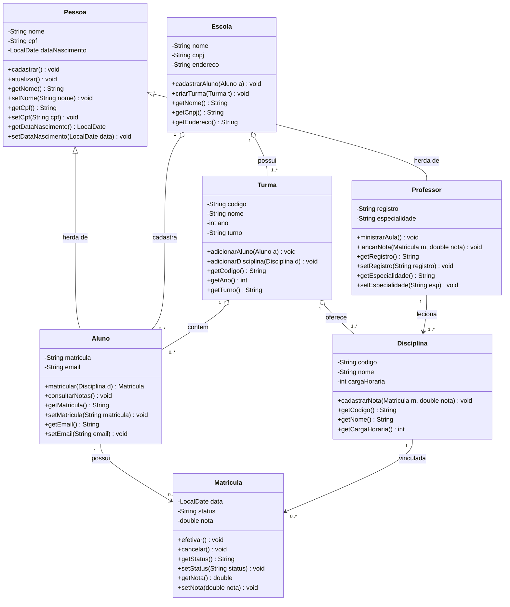
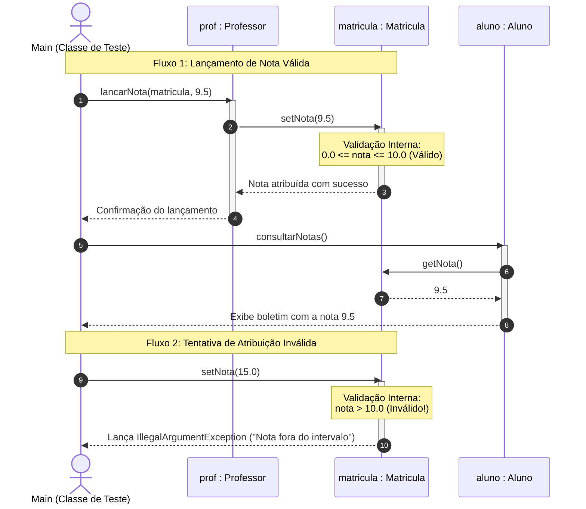

# RELATÓRIO TÉCNICO DE IMPLEMENTAÇÃO — FASE 02
## Disciplina: Desenvolvimento Orientado a Objetos (6º Período)
**Tema:** Aplicação Prática de Encapsulamento, Validações e Boas Práticas em Java  
**Domínio:** Sistema de Gestão Escolar  
**Ambiente de Desenvolvimento:** Java JDK 17 LTS / StarUML  

---

## 1. INTRODUÇÃO E CONTEXTO

O presente documento consolida a entrega da **Fase 02** do projeto prático da disciplina de Desenvolvimento Orientado a Objetos. Na Fase 01, foi realizada a concepção conceitual do domínio e a modelagem do diagrama de classes UML para um sistema de gestão escolar, identificando as seguintes entidades fundamentais:
- `Pessoa` (superclasse base)
- `Aluno` e `Professor` (subclasses especializadas via herança)
- `Escola`, `Turma` e `Disciplina` (entidades de agregação e composição estrutural)
- `Matricula` (classe associativa entre Aluno e Disciplina)

O objetivo central desta **Fase 02** é a transposição do modelo para código-fonte funcional em linguagem Java, com foco primordial na aplicação rigorosa do pilar de **Encapsulamento**. A meta foi garantir que nenhum dado interno das classes seja modificado de forma arbitrária ou inconsistente, delegando o controle de leitura e mutação exclusivamente a métodos de acesso (*getters* e *setters*) providos de validações lógicas e defensivas.

---

## 2. FUNDAMENTAÇÃO TEÓRICA E BOAS PRÁTICAS

### 2.1 O Pilar do Encapsulamento
O encapsulamento visa ocultar a estrutura interna dos dados de um objeto, expondo apenas uma interface pública segura para o mundo externo. Isso assegura que:
1. **Invariantes de Domínio sejam preservados:** Um objeto nunca atinge um estado inválido (ex.: nota de aluno negativa ou maior que 10).
2. **Baixo Acoplamento e Alta Coesão:** Alterações nas estruturas internas de armazenamento não quebram o código cliente que as consome.

### 2.2 Modificadores de Acesso
Em conformidade com as diretrizes do enunciado da atividade:
- Todos os atributos de todas as classes foram definidos com visibilidade **`private`**.
- As operações públicas foram declaradas como **`public`**.
- Métodos auxiliares de controle interno foram protegidos (`protected` ou `package-private`).

### 2.3 Métodos *Getters* e *Setters* com Validação Defensiva
Diferente de implementações ingênuas que apenas atribuem valores diretamente (`this.x = x`), os *setters* foram codificados como **barreiras de integridade**:
- Validações de formato, limites numéricos e regras de domínio são executadas antes de aceitar qualquer alteração.
- Em caso de violação de regra, o sistema adota o padrão moderno do Java, disparando uma exceção do tipo `IllegalArgumentException` com mensagem explicativa (*Fail-Fast*).

### 2.4 Proteção no Construtor
Para impedir que um objeto nasça com valores inválidos contornando os *setters*, os construtores de todas as classes utilizam os próprios métodos *setters* para inicializar os atributos.

### 2.5 Encapsulamento de Coleções
Para atributos multivalorados (listas de alunos, turmas e disciplinas), os métodos *getters* retornam visões imutáveis através de `Collections.unmodifiableList(...)`, impedindo que código externo adicione ou remova itens sem passar pelos métodos de negócio da própria classe (`adicionarAluno()`, `criarTurma()`, etc.).

---

## 3. MODELAGEM UML E ARQUITETURA DO SISTEMA

Para documentar formalmente a transição e aprimoramento da modelagem da Fase 01 para a Fase 02, foram elaborados dois diagramas segundo o padrão internacional **UML 2.5 (Unified Modeling Language)**:

### 3.1 Diagrama de Classes UML Atualizado (Visão Estrutural)
Este diagrama refina a modelagem original da Fase 01, incorporando os modificadores de visibilidade privada (`-`) para todos os atributos, métodos de acesso públicos (`+`), multiplicidades formais nas extremidades das associações e a notação canônica de herança (generalização) com triângulo vazado apontando para `Pessoa`.



---

### 3.2 Diagrama de Sequência UML (Visão Dinâmica do Encapsulamento)
O diagrama abaixo demonstra a linha do tempo das invocações entre os objetos, evidenciando o momento em que a regra de negócio protege o atributo `nota` contra manipulações indevidas:



---

### 3.3 Tabela Comparativa de Atributos e Regras de Validação

Abaixo sintetizam-se as classes implementadas no pacote `escola`, seus atributos protegidos e as respectivas regras de validação aplicadas nos *setters*:

| Classe | Atributo | Tipo | Visibilidade | Regra de Validação Aplicada |
|---|---|---|---|---|
| **`Pessoa`** | `nome` | `String` | `private` | Não nulo, não vazio e com tamanho mínimo de 2 caracteres. |
| | `cpf` | `String` | `private` | Remove caracteres não numéricos e exige exatamente 11 dígitos. |
| | `dataNascimento` | `LocalDate` | `private` | Não nula e não pode ser uma data futura. |
| **`Aluno`** | `matricula` | `String` | `private` | Não nula e não vazia. Identificador único do aluno. |
| | `email` | `String` | `private` | Expressão regular validando estrutura formal (`usuario@dominio.com`). |
| **`Professor`**| `registro` | `String` | `private` | Não nulo e não vazio. Código funcional do docente. |
| | `especialidade` | `String` | `private` | Não nula e não vazia (área de atuação acadêmica). |
| **`Escola`** | `nome` | `String` | `private` | Não nulo e não vazio. |
| | `cnpj` | `String` | `private` | Remove pontuações e valida obrigatoriedade de 14 dígitos. |
| | `endereco` | `String` | `private` | Não nulo e não vazio. |
| **`Turma`** | `codigo` / `nome` | `String` | `private` | Não nulos e não vazios. |
| | `ano` | `int` | `private` | Deve pertencer a um intervalo letivo válido (2000 a 2100). |
| | `turno` | `String` | `private` | Não nulo e não vazio (ex.: Manhã, Tarde, Noite, Integral). |
| **`Disciplina`** | `codigo` / `nome`| `String` | `private` | Não nulos e não vazios. |
| | `cargaHoraria` | `int` | `private` | Valor obrigatoriamente superior a zero ($> 0$). |
| **`Matricula`** | `aluno` / `disciplina` | Objetos | `private` | Não podem ser nulos no vínculo de matrícula. |
| | `status` | `String` | `private` | Restrito aos valores válidos: `ATIVA`, `CANCELADA`, `CONCLUIDA`, `TRANCADA`. |
| | `nota` | `double` | `private` | **Regra crítica:** nota deve estar estritamente entre `0.0` e `10.0`. |

---

## 4. EVIDÊNCIAS DE EXECUÇÃO E TESTES EXPERIMENTAIS

Para certificar o cumprimento de todos os requisitos, foi desenvolvida a classe executável [`Main.java`](src/escola/Main.java), estruturada em dois cenários:
1. **Cenário Nominal:** Instanciação completa do ecossistema escolar, execução de cadastros, enturmação, matrícula de aluno em disciplina, atuação do professor lecionando e lançando nota, e consulta final do boletim escolar.
2. **Cenário de Estresse (Testes de Encapsulamento):** Oito tentativas sucessivas de inserção de valores inválidos em atributos privados, certificando a ação das validações.

### 4.1 Registro de Execução no Terminal

O log abaixo reproduz a compilação e a execução real do sistema no ambiente Windows PowerShell:

```text
PS D:\Faculdade\6 periodo\Desenvolvimento orientado a objeto> javac -encoding UTF-8 -d bin src/escola/*.java
PS D:\Faculdade\6 periodo\Desenvolvimento orientado a objeto> java "-Dfile.encoding=UTF-8" -cp bin escola.Main
======================================================================
   FASE 02: DEMONSTRAÇÃO PRÁTICA DE ENCAPSULAMENTO E BOAS PRÁTICAS   
======================================================================

--- 1. Instanciação e Manipulação de Objetos Válidos ---
[OK] Escola: Colégio Futuro Brilhante | CNPJ: 12345678000199 | Endereço: Av. Universitária, 1000 | Qtd. Turmas: 0
[Pessoa] Cadastro realizado com sucesso para: Carlos Eduardo
[OK] Nome: Carlos Eduardo | CPF: 11122233344 | Data Nasc.: 20/05/1982 | Registro: PROF-2024-01 | Especialidade: Programação Orientada a Objetos
[Pessoa] Cadastro realizado com sucesso para: Maria Eduarda Souza
[OK] Nome: Maria Eduarda Souza | CPF: 99988877766 | Data Nasc.: 15/03/2005 | Matrícula: ALU-2026-987 | E-mail: maria.souza@faculdade.edu.br
[Escola Colégio Futuro Brilhante] Turma criada: Engenharia de Software - 6º Período (T-2026-N)
[Escola Colégio Futuro Brilhante] Aluno cadastrado: Maria Eduarda Souza
[Turma T-2026-N] Aluno adicionado com sucesso: Maria Eduarda Souza
[Turma T-2026-N] Disciplina vinculada à turma: Programação Orientada a Objetos
[Aluno] Maria Eduarda Souza matriculado na disciplina: Programação Orientada a Objetos
[OK] Matrícula [ATIVA] Aluno: Maria Eduarda Souza | Disciplina: Programação Orientada a Objetos | Data: 19/10/2026 | Nota: 0,0
[Professor] O(a) Prof(a). Carlos Eduardo está ministrando aula de Programação Orientada a Objetos.
[Professor] O(a) Prof(a). Carlos Eduardo lançou a nota 9.5 para o(a) aluno(a) Maria Eduarda Souza na disciplina Programação Orientada a Objetos
=== Boletim de Notas: Maria Eduarda Souza (Matrícula: ALU-2026-987) ===
Disciplina: Programação Orientada a Objetos | Nota: 9.5 | Status: ATIVA
=========================================================

--- 2. Testando a Proteção do Encapsulamento contra Dados Inválidos ---
Tentativas de atribuir dados incorretos via setters serão barradas:

[TESTE] Tentativa de lançar nota acima do limite (15.0) -> PROTEGIDO COM SUCESSO! Exceção capturada: "Erro de validação: A nota deve estar entre 0.0 e 10.0. Valor informado: 15.0"
[TESTE] Tentativa de lançar nota negativa (-2.5) -> PROTEGIDO COM SUCESSO! Exceção capturada: "Erro de validação: A nota deve estar entre 0.0 e 10.0. Valor informado: -2.5"
[TESTE] Tentativa de cadastrar CPF com tamanho inválido ('123') -> PROTEGIDO COM SUCESSO! Exceção capturada: "Erro de validação: O CPF deve conter exatamente 11 dígitos numéricos."
[TESTE] Tentativa de atribuir e-mail sem '@' ('email_invalido.com') -> PROTEGIDO COM SUCESSO! Exceção capturada: "Erro de validação: O e-mail informado ('email_invalido.com') é inválido."
[TESTE] Tentativa de cadastrar disciplina com carga horária zero (0h) -> PROTEGIDO COM SUCESSO! Exceção capturada: "Erro de validação: A carga horária da disciplina deve ser maior que zero."
[TESTE] Tentativa de atribuir nome vazio a uma Pessoa -> PROTEGIDO COM SUCESSO! Exceção capturada: "Erro de validação: O nome não pode ser nulo ou vazio."
[TESTE] Tentativa de atribuir CNPJ com quantidade incorreta de dígitos -> PROTEGIDO COM SUCESSO! Exceção capturada: "Erro de validação: O CNPJ deve conter exatamente 14 dígitos numéricos."
[TESTE] Tentativa de definir status não previsto ('APROVADO_DIRETO') -> PROTEGIDO COM SUCESSO! Exceção capturada: "Erro de validação: Status inválido ('APROVADO_DIRETO'). Valores aceitos: [ATIVA, CANCELADA, CONCLUIDA, TRANCADA]"

--- 3. Verificação Final do Estado do Objeto ---
Observe que, mesmo após as tentativas inválidas, os objetos mantêm seu estado protegido e íntegro:
-> Aluno: Maria Eduarda Souza (CPF: 99988877766, E-mail: maria.souza@faculdade.edu.br)
-> Nota da Matrícula permanece: 9.5

[SUCESSO] Todos os conceitos de encapsulamento foram validados com êxito!
```

### 4.2 Análise dos Resultados
1. **Comportamento Nominal:** Todas as 7 classes foram instanciadas harmoniosamente, respeitando as associações e heranças do modelo UML original.
2. **Eficácia da Blindagem por Encapsulamento:** Em nenhum dos 8 testes de estresse o objeto teve seu estado corrompido. Como demonstrado na "Verificação Final do Estado", a nota da matrícula manteve-se intacta em `9.5`, o CPF preservou seus 11 dígitos válidos e o e-mail não foi substituído pelo valor inválido.

---

## 5. CONCLUSÃO

A implementação prática da Fase 02 atendeu integralmente aos objetivos pedagógicos e técnicos propostos para a disciplina de Desenvolvimento Orientado a Objetos:

1. **Proteção Rigorosa dos Atributos:** Nenhum atributo foi exposto publicamente; todos receberam o modificador `private`.
2. **Intermediação por Getters e Setters:** As operações de leitura e escrita foram concentradas em métodos explícitos, impedindo acessos acidentais ou nocivos.
3. **Consistência de Negócio e Fail-Fast:** A inclusão de checagens com disparo de exceções em dados corrompidos (notas fora de escala, strings nulas ou vazias, formatos fora de padrão) garantiu a solidez de todo o sistema escolar.
4. **Alinhamento ao Modelo UML:** O código reflete com exatidão a hierarquia de herança e as associações projetadas na Fase 01, servindo de base sólida para as próximas etapas do projeto acadêmico.

